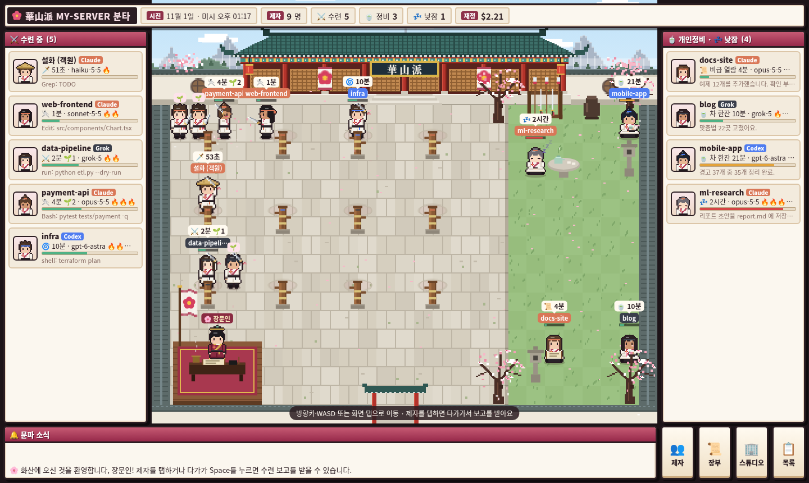
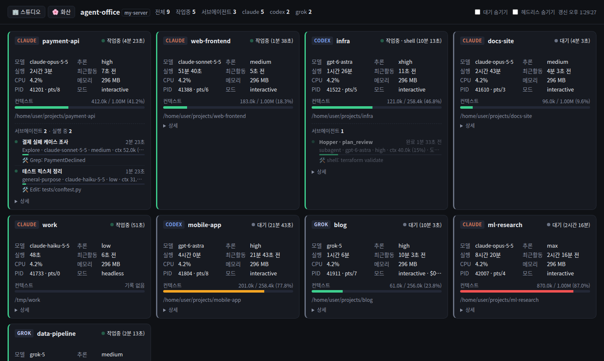
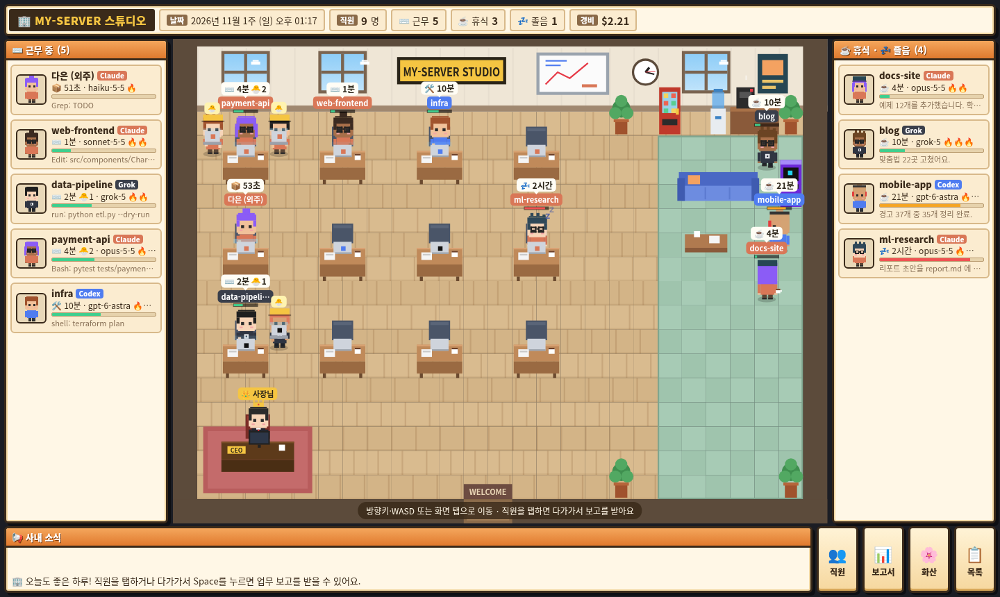
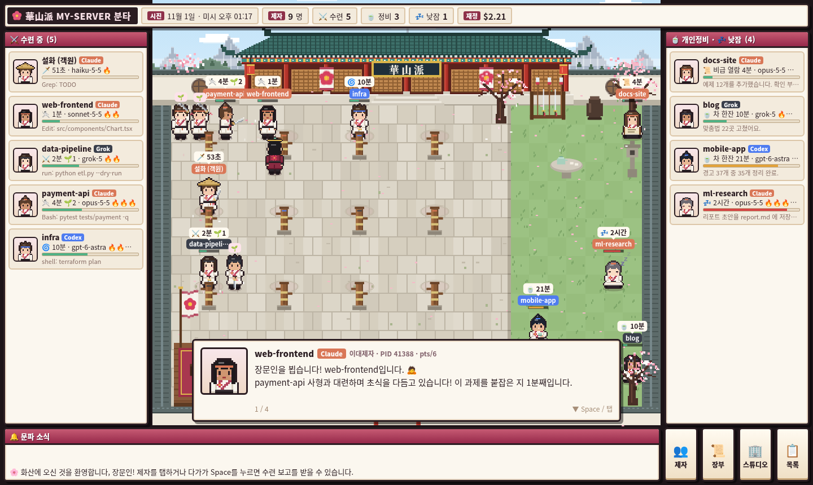

# agent-office

AI 에이전트들이 일하는 사무실. 내 계정에서 돌고 있는 AI 코딩 에이전트(**Claude Code**, **Codex**, **Grok**) 프로세스를 웹 화면으로 보여 줍니다.
Tailscale로 다른 기기(폰·노트북)에서 접속하는 것을 전제로 만들었습니다.



프로세스마다 다음을 보여 줍니다.

- 상태: 작업 중 / 대기 / 셸 명령 실행 중 / 일시정지
- 진행 시간: 프로세스 실행 시간, 현재 상태로 바뀐 뒤 지난 시간
- 모델, 추론 깊이(effort)
- 컨텍스트 사용량 (사용 토큰 / 컨텍스트 창)
- 맡은 작업(첫 지시), 최근 도구 호출과 응답
- CPU, 메모리, 비용(Grok만)
- **서브에이전트**: 세션이 나눠 맡긴 하위 에이전트의 작업 설명, 모델, 컨텍스트, 최근 활동, 실행 중/완료

## 화면

| 주소 | 화면 |
|---|---|
| `/` | **리스트** — 세션별 카드 목록. 대기·헤드리스 숨기기 필터 |
| `/studio` | **AI 스튜디오** — 게임 회사 경영 게임 풍. 사무실에서 각 프로세스가 직원(NPC)으로 일하고, 사장님 캐릭터로 다가가면 업무 보고를 받음 |
| `/hwasan` | **화산파 수련장** — 무협 풍. 일하는 프로세스는 연무장에서 수련·대련하고, 쉬는 프로세스는 정원에서 개인정비. 나는 장문인 |
| `/api/sessions` | 위 화면들이 쓰는 JSON |

세 화면 모두 3초마다 갱신되고, 화면 안의 버튼으로 서로 오갈 수 있습니다.
아래 캡처는 모두 데모 데이터로 찍은 것입니다.

### 리스트 `/`

카드 아래쪽에 그 세션의 서브에이전트 목록이 나옵니다. 끝난 서브에이전트는 흐리게 10분 동안 더 보입니다.



### AI 스튜디오 `/studio`

일하는 직원은 책상에서 타이핑하고, 쉬는 직원은 오른쪽 휴게실로 갑니다. 1시간 넘게 대기하면 자리에서 좁니다.
머리 위에는 현재 상태와 경과 시간, 이름, 컨텍스트 사용량 바가 표시됩니다.
서브에이전트는 노란 모자를 쓴 **인턴**(🐣)으로 나와 부모 직원 책상 옆에 서서 노트북으로 일하고, 일이 끝나면 사라집니다.



### 화산파 수련장 `/hwasan`

일하는 제자는 목인장 앞에서 검법을 수련하고, 옆자리 제자도 일하는 중이면 둘이 나와 대련합니다.
쉬는 제자는 정원에서 운기조식·차·검 손질·비급 열람 같은 개인정비를 하고, 오래 대기하면 낮잠을 잡니다.
제자에게 다가가면 맡은 과제, 최근 활동, 모델·내공(추론 깊이)·기력 소모(컨텍스트)를 보고합니다.
서브에이전트는 **사제**(🌱)로 나와 사형 곁에서 함께 수련하고, 과제를 마치면 물러납니다.



게임 화면 조작:

- 이동: 방향키·WASD 또는 화면 탭
- 보고 받기: NPC 근처에서 Space/Enter/E, 또는 NPC를 탭
- Esc: 대화창·창 닫기
- 화면이 넓으면 양옆에 작업 중 / 쉬는 중 목록이 나오고, 목록 항목을 누르면 그 NPC에게 걸어갑니다.
- 인턴·사제는 탭하면 보고를 받을 수 있습니다. 한 명 곁에는 최대 2명까지 보이고, 나머지는 이름 옆 배지 숫자(🐣3, 🌱3)로만 표시됩니다.

## 제약

- **Linux 전용.** 프로세스 정보를 `/proc`에서 읽습니다. macOS·Windows에서는 동작하지 않습니다(WSL2는 미확인).
- **실행한 계정의 프로세스만** 보입니다. 다른 사용자의 에이전트는 표시되지 않습니다.
- **PC 한 대 = 서버 하나.** 여러 PC의 세션을 한 화면에 모으는 기능은 없습니다. PC마다 따로 실행하고 따로 접속하세요.
- 정보는 각 도구가 디스크에 남기는 기록 파일에서 읽어 옵니다. 그래서 다음과 같은 한계가 있습니다.
  - **Codex `exec --ephemeral`** 처럼 기록을 남기지 않는 실행은 모델·추론 깊이를 명령줄 인자에서만 알 수 있고, 컨텍스트·작업 내용은 "정보 없음"으로 나옵니다.
  - **Claude 컨텍스트 창은 1M 토큰으로 고정**해서 계산합니다(`monitor.py`의 `CLAUDE_CONTEXT_WINDOW`).
  - **비용**은 Grok 세션만 기록이 있어서 Grok만 집계됩니다.
  - **서브에이전트**
    - Claude는 "마지막 응답이 도구 호출 없이 끝났는지"로 완료 여부를 판단합니다. 30분 넘게 기록이 멈춘 서브에이전트는 끝난 것으로 봅니다.
    - Codex 서브에이전트의 지시 내용은 기록에 암호화되어 있어 표시되지 않습니다. 자동 승인 검토용 `guardian`은 사람이 시킨 작업이 아니라 제외합니다.
    - 서브에이전트는 부모 프로세스가 시작된 뒤에 생긴 것만 보여 줍니다.
  - 각 도구가 업데이트로 기록 파일 형식을 바꾸면 일부 항목이 비어 보일 수 있습니다.
- **인증이 없습니다.** 작업 지시 내용, 작업 폴더 경로, 최근 도구 호출이 그대로 보입니다. 아래 "보안" 항목을 꼭 읽어 주세요.

## 요구 사항

- Linux, Python 3.8 이상 (표준 라이브러리만 사용, 추가 패키지 없음)
- [Tailscale](https://tailscale.com/) (선택). 없으면 `127.0.0.1`에만 열립니다.
- 브라우저: 최신 Chrome / Safari / Firefox (Canvas 사용, 모바일 지원)

## 설치

`monitor.py`, `list.html`, `studio.html`, `hwasan.html` 네 파일을 **같은 폴더**에 두기만 하면 됩니다. 폴더 위치와 실행 위치는 상관없습니다.

```bash
# 예: 다른 PC로 복사
scp -r agent-office 다른PC:~/apps/
```

## 실행

```bash
python3 /경로/agent-office/monitor.py
# agent-office: http://100.x.y.z:8787
```

출력된 주소를 Tailscale에 연결된 기기의 브라우저에서 엽니다.

옵션:

| 옵션 | 설명 |
|---|---|
| `--host 주소` | 바인드 주소. 기본은 `tailscale ip -4` 결과, 실패하면 `127.0.0.1` |
| `--port 번호` | 포트. 기본 `8787` |
| `--dump` | 수집한 세션 정보를 JSON으로 한 번 출력하고 종료 (동작 확인용) |
| `--install-service` | systemd 사용자 서비스로 등록하고 시작 (아래 참고) |

`--host 0.0.0.0` 은 모든 네트워크(LAN·공인 IP 포함)에 열리므로 권장하지 않습니다.

## 서비스로 띄우기 (systemd)

부팅할 때 자동으로 켜지고, 죽으면 5초 뒤 다시 살아나게 하려면:

```bash
python3 /경로/agent-office/monitor.py --install-service
# 포트나 주소를 바꾸려면 같이 지정
python3 /경로/agent-office/monitor.py --install-service --port 9000
```

이 명령은 다음을 합니다.

1. 지금 실행한 Python과 `monitor.py`의 **현재 절대 경로**로 `~/.config/systemd/user/agent-office.service` 를 만듭니다.
2. `systemctl --user daemon-reload` → `enable --now` → `restart` 를 실행합니다.

폴더를 옮기거나 옵션을 바꿨다면 같은 명령을 다시 실행하면 됩니다.

로그아웃한 상태(또는 재부팅 후 로그인 전)에도 계속 돌게 하려면 한 번만:

```bash
sudo loginctl enable-linger $USER
```

관리 명령:

```bash
systemctl --user status agent-office      # 상태
journalctl --user -u agent-office -f      # 로그
systemctl --user restart agent-office     # 재시작 (코드 수정 후)
systemctl --user disable --now agent-office   # 중지 + 자동 실행 해제
rm ~/.config/systemd/user/agent-office.service && systemctl --user daemon-reload   # 완전 삭제
```

HTML 파일만 고친 경우에는 재시작 없이 브라우저 새로고침으로 반영됩니다. `monitor.py`를 고치면 재시작이 필요합니다.

부팅 직후 Tailscale이 아직 준비되지 않았으면 IP를 못 찾아 `127.0.0.1`로 뜰 수 있습니다. 그럴 땐 `--host 100.x.y.z` 로 등록해 두면, Tailscale이 올라올 때까지 실패와 재시작을 반복하다가 붙습니다.

## 동작 방식

1. `/proc/*/cmdline` 에서 실행 파일 이름이 `claude`, `codex`, `grok`(또는 `node`/`bun`으로 실행된 같은 이름)인 프로세스를 찾습니다.
   - 같은 종류의 부모 프로세스(래퍼)는 하나로 합칩니다.
   - Codex의 보조 프로세스(`app-server`, `mcp-server`, `proto`, `responses-api-proxy`)는 제외합니다.
2. 종류별로 기록 파일을 찾아 상태를 읽습니다.

| 도구 | 읽는 파일 | 얻는 정보 |
|---|---|---|
| Claude Code | `~/.claude/sessions/<pid>.json`, `~/.claude/projects/<폴더>/<세션>.jsonl` | 상태, 세션 이름, 모델, effort, 토큰 사용량, 작업·최근 활동 |
| Codex | `~/.codex/sessions/YYYY/MM/DD/rollout-*.jsonl`, `~/.codex/session_index.jsonl` | 모델, effort, 컨텍스트, 작업 시작/완료, 스레드 이름 |
| Grok | `~/.grok/active_sessions.json`, `~/.grok/sessions/<폴더>/<세션>/` (summary, signals, events, usage, updates, chat_history) | 모델, effort, 컨텍스트, 상태, 비용, 제목 |

서브에이전트는 따로 프로세스를 띄우지 않고 부모 프로세스 안에서 돌기 때문에, 부모 세션의 기록 옆에서 찾습니다.

| 도구 | 서브에이전트 기록 |
|---|---|
| Claude Code | `~/.claude/projects/<폴더>/<세션>/subagents/agent-*.jsonl` + `.meta.json` (종류, 설명) |
| Codex | 별도 `rollout-*.jsonl`. 첫 줄 `session_meta.source.subagent.thread_spawn.parent_thread_id` 로 부모를 찾음 |
| Grok | `~/.grok/sessions/<폴더>/<세션>/subagents/<id>/meta.json` (상태, 설명, 모델, 시작·완료 시각) |

파일은 변경 시각·크기 기준으로 캐시하고, 큰 로그는 끝부분만 읽습니다.

상태 표시 기준:

- **작업 중**: 에이전트가 턴을 처리하는 중 (셸 명령 대기 포함)
- **대기 / 휴식**: 다음 지시를 기다리는 중
- **졸음 / 낮잠**: 대기가 1시간 이상 계속됨 (게임 화면 전용 표현)
- **정지 / 점혈**: 프로세스가 `SIGSTOP` 등으로 멈춤

## 보안

- 서버에는 로그인이 없습니다. **접속할 수 있는 사람은 누구나** 작업 지시문, 폴더 경로, 최근 명령을 볼 수 있습니다.
- 기본값(Tailscale IP에만 바인드)을 유지하면 내 tailnet 기기에서만 접속됩니다. tailnet을 다른 사람과 공유한다면 Tailscale ACL로 접근을 제한하세요.
- 서버는 읽기 전용입니다. 프로세스를 멈추거나 조작하는 기능은 없습니다.
- API 응답에서는 비밀값으로 보이는 문자열을 `***` 로 가립니다. 명령줄, 작업 지시, 도구 호출 기록이 모두 대상입니다.
  - `--api-key xxx`, `--token=xxx` 처럼 이름에 key/token/secret/password/auth/credential 이 들어간 옵션의 값
  - `OPENAI_API_KEY=xxx` 같은 환경 변수 지정
  - `Bearer xxx`
  - `sk-…`, `xai-…`, `ghp_…`, `AKIA…` 등 잘 알려진 키 형식

  패턴 기반이라 모든 비밀값을 잡지는 못합니다. 예를 들어 이름 없이 그냥 적힌 비밀번호는 걸러지지 않습니다. 접근 제한이 기본 방어선입니다.

## 파일 구성

```
monitor.py   수집 + HTTP 서버 (표준 라이브러리)
LICENSE      MIT
docs/        README 화면 캡처
list.html    /         리스트 화면
studio.html  /studio   AI 스튜디오 게임 화면
hwasan.html  /hwasan   화산파 수련장 게임 화면
```

## 문제 해결

- **세션이 하나도 안 보임**: 서버를 에이전트와 같은 계정으로 실행했는지 확인하세요. `python3 monitor.py --dump` 로 무엇이 잡히는지 볼 수 있습니다.
- **다른 기기에서 접속이 안 됨**: 출력된 주소가 `127.0.0.1` 이면 Tailscale IP를 못 찾은 것입니다. `tailscale ip -4` 가 되는지 확인하거나 `--host` 를 직접 지정하세요.
- **포트 충돌** (`Address already in use`): 이미 서비스로 떠 있는지 `systemctl --user status agent-office` 로 확인하거나 `--port` 를 바꾸세요.
- **모델·컨텍스트가 "정보 없음"**: 기록을 남기지 않는 실행(Codex ephemeral 등)이거나, 아직 첫 응답이 오기 전입니다.
- **이모지가 네모로 보임**: 접속한 기기에 이모지 폰트가 없는 경우입니다(서버 쪽 문제 아님).

## 라이선스

[MIT](LICENSE)
